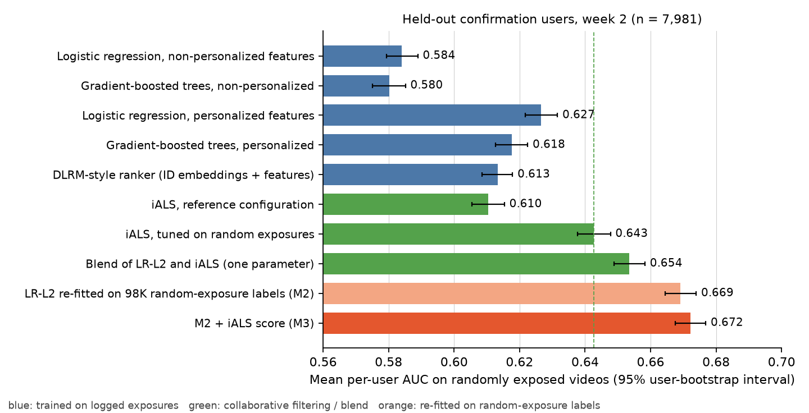
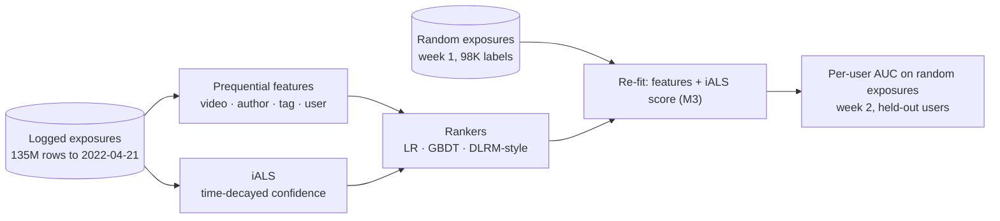
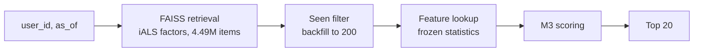

# kuairand-recsys

Short-video recommendation on [KuaiRand](https://kuairand.com) (Kuaishou logs): retrieval and ranking models trained
on 135M logged exposures, evaluated on randomly exposed videos, adapted with random-exposure labels, and served through
a two-stage FAISS + FastAPI demo.

  



## Highlights

- **Evaluation on random exposures.** KuaiRand records what a random policy showed to users; every model is scored by
  per-user AUC on those exposures, free of the production policy's selection.
- **Label source matters more than model class.** Trained on logged exposures, a tuned iALS (0.643) beats logistic
  regression (0.627), gradient-boosted trees (0.618) and a DLRM-style ranker (0.613) on the same personalized features.
  Re-fitting the feature model on 98K random-exposure labels reaches 0.672: **+0.030 over the tuned iALS (95% CI
  0.025–0.034)** on 7,981 held-out users, replicated in a second week. With identical features, random labels beat logged
  labels from the same week by +0.058.
- **Why fusion fails on logged data.** For the same users, week and videos, the iALS score's per-user AUC is 0.60 under
  recommended exposure and 0.65 under random exposure, while a feature model's is unchanged; a ranker trained on logged
  exposures therefore gives the collaborative score no weight.
- **Out-of-core on a 16 GB laptop.** Strictly-earlier (prequential) features for 135M rows streamed from the archive and
  verified bit-for-bit against an in-memory implementation; protocols fixed before each run, three user tiers, paired
  user bootstrap on every contrast.
- **Serving demo.** FAISS retrieval over 4.49M item vectors, seen filter, feature lookup and M3 scoring behind FastAPI;
  reproduces the offline scores (max difference 7e-8) at 64 ms p95 per request on an Apple M1.

## How it works



- **Temporal cutoff.** Training history ends 2022-04-21; evaluation windows are 04-22..04-28 (week 1) and 04-29..05-08
  (week 2). Every training statistic uses only strictly earlier events; evaluation features are frozen at the cutoff.
- **User tiers.** Users are split by seed before modelling: tune (hyperparameters), report (development results) and
  13,143 confirmation users, evaluated on week 2 (primary) and week 1.
- **Protocols.** Each stage has a JSON protocol fixed before running (`results/expansion/protocol_*.json`): grids,
  selection and tie rules, and the decision rule (+0.01 per-user AUC with a 95% interval excluding 0).
- **Models.** Time-decayed-confidence iALS (exact ALS solves); logistic regression and HistGradientBoosting on
  prequential video / author / tag / user-interaction features; a DLRM-style ranker with ID embeddings under
  expected-touch-normalized priors; a one-parameter blend; ridge-logistic re-fits on random-exposure labels (M2:
  features; M3: features + iALS score).
- **Statistics.** Per-user AUC, seeds averaged per user, paired user bootstrap (2,000 resamples) for every contrast.

Details: [docs/method.md](docs/method.md).

## Results

Per-user AUC on randomly exposed videos, confirmation users (held out before modelling):

| Model | Week 2 (7,981 users) | Week 1 (3,260 users) |
|---|---:|---:|
| Logistic regression, non-personalized features (LR-L1) | 0.584 | 0.589 |
| Logistic regression, personalized features (LR-L2) | 0.627 | 0.635 |
| Gradient-boosted trees, same features (Tree-L2) | 0.618 | 0.626 |
| DLRM-style ranker, ID embeddings + same features (Deep-L2) | 0.613 | 0.619 |
| iALS, reference configuration | 0.610 | 0.609 |
| iALS, tuned on random exposures | 0.643 | 0.647 |
| Blend of LR-L2 and iALS (one parameter) | 0.654 | 0.662 |
| LR-L2 re-fitted on 98K random-exposure labels (M2) | 0.669 | 0.673 |
| **M2 + iALS score (M3)** | **0.672** | **0.678** |

| Contrast (paired user bootstrap, 95% CI) | Week 2 | Week 1 |
|---|---|---|
| **M3 − tuned iALS** | **+0.030 [+0.025, +0.034]** | +0.032 [+0.022, +0.041] |
| M2 − LR-L2 (same features, random vs logged labels) | +0.042 [+0.039, +0.046] | +0.038 [+0.030, +0.046] |
| LR-L2 − tuned iALS | −0.016 [−0.021, −0.011] | −0.012 [−0.022, −0.001] |
| Blend − tuned iALS | +0.011 [+0.008, +0.014] | +0.016 [+0.009, +0.022] |
| LR-L2 − LR-L1 (personalized features) | +0.043 [+0.040, +0.045] | +0.047 [+0.041, +0.053] |
| Tree-L2 − LR-L2 | −0.009 [−0.011, −0.007] | −0.009 [−0.014, −0.005] |
| Deep-L2 − LR-L2 | −0.013 [−0.015, −0.011] | −0.016 [−0.021, −0.011] |

Full outputs: `results/expansion/run_confirmation/`.

**Label source vs recency** (development users, week 2; `results/expansion/run_dev/ext_source.json`). Same users, week,
features and fitting procedure: training on week-1 random exposures beats training on week-1 recommended exposures by
+0.058 [+0.054, +0.062] (+0.046 when both are restricted to the random-pool videos), and the week-1 logged re-fit scores
0.013 below the 6M-row logged-exposure model, so fresher logged data is not what helps.

**Exposure mechanism** (development users; `results/expansion/exposure_diagnostic.json`). Same users, week and
random-pool videos: iALS score per-user AUC 0.60 under recommended exposure, 0.65 under random exposure; LR-L2
unchanged.

**Retrieval** (KuaiRand-1K, held-out test period, 2.1M-item catalog; `results/test_phase_v2/`, `results/seq_retrieval/`).
Time-decayed-confidence iALS reaches Recall@100 1.79% against 1.06% for time-decayed popularity (+69%), ahead of binary
iALS, BPR, a latent-space model and SASRec.

## Installation

```sh
git clone https://github.com/FeifanJiang/kuairand-recsys && cd kuairand-recsys
python3.12 -m venv .venv && .venv/bin/pip install -r requirements-lock.txt   # torch 2.14, pandas 3.0, scikit-learn 1.9
.venv/bin/python scripts/feature_model_checks.py                            # smoke test on a synthetic table, no data needed
```

## Data

Download `KuaiRand-1K`, `KuaiRand-Pure` and `KuaiRand-27K` from https://kuairand.com (also on
[Zenodo record 10439422](https://zenodo.org/records/10439422)); placement, MD5s and extraction are in
[docs/reproduction.md](docs/reproduction.md#2-data). The 27K archive is streamed, never extracted. The data are not
redistributed here; `data/splits/` holds the user partitions.

## Reproducing the study

[docs/reproduction.md](docs/reproduction.md) lists every command in order with time and memory per step (about 11 hours
serial on an 8-core, 16 GB laptop, CPU only). The scripts write to `reports/` (git-ignored); the reference outputs they
are compared with live in `results/`.

## Serving demo



```sh
.venv/bin/pip install -r requirements-serving.txt
.venv/bin/python serving/build_bundle.py --version v1    # lookup tables, seen sets, FAISS indexes, manifest (~10 min, 5.6 GB)
.venv/bin/python serving/check_correctness.py            # service scores == offline scores
.venv/bin/python serving/benchmark.py                    # latency, throughput, peak memory
.venv/bin/uvicorn serving.app:app --port 8000            # GET /recommend?user_id=...   POST /score
```

Apple M1 (8 cores), one worker, 200 candidates, k = 20:

| Index | Concurrency | p50 ms | p95 ms | req/s |
|---|---:|---:|---:|---:|
| exact (`IndexFlatIP`) | 1 | 57 | 64 | 17 |
| exact | 16 | 620 | 880 | 25 |
| HNSW (efSearch 128) | 1 | 44 | 47 | 23 |
| HNSW | 16 | 473 | 705 | 33 |

Retrieval takes 12 ms (exact) or under 1 ms (HNSW); the rest is feature assembly and scoring for 200 candidates. The
service reproduces the offline M3 scores to 7e-8. HNSW recovers 69% of the exact top-200 at efSearch 128, so the exact
index is the default. Details and API: [serving/README.md](serving/README.md).

## Repository layout

```
scripts/      pipeline, models, evaluation and check scripts         -> scripts/README.md
serving/      bundle builder, feature lookup, recommender, FastAPI app, correctness check, benchmark
results/      reference outputs: protocols, selection records, result tables, checks   -> results/README.md
docs/         method.md, reproduction.md, figures/
data/splits/  fixed user partitions (everything else under data/ and artifacts/ is generated)
reports/      written by the scripts when you run them (git-ignored)
```

## Citation

Dataset: Gao et al., *KuaiRand: An Unbiased Sequential Recommendation Dataset with Randomly Exposed Videos*, CIKM 2022.

```bibtex
@inproceedings{gao2022kuairand,
  title     = {KuaiRand: An Unbiased Sequential Recommendation Dataset with Randomly Exposed Videos},
  author    = {Gao, Chongming and Li, Shijun and Zhang, Yuan and Chen, Jiawei and Li, Biao and Lei, Wenqiang and Jiang, Peng and He, Xiangnan},
  booktitle = {Proceedings of the 31st ACM International Conference on Information and Knowledge Management},
  year      = {2022}
}
```

## License

MIT. The dataset is distributed under its own terms.
